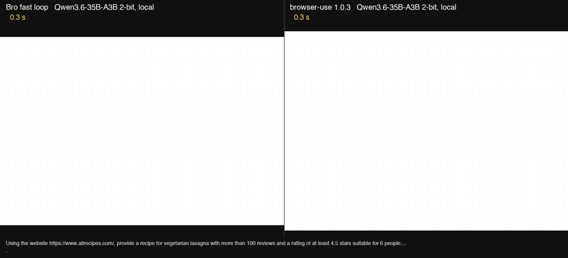

# Bro: the fastest local browser agent

Bro is a browser agent that runs entirely on your laptop. On the same local model, the same machine and the same 150
[Emergence WebVoyager](https://github.com/EmergenceAI/EmergenceWebVoyager) tasks, it solves more tasks than
[browser-use](https://github.com/browser-use/browser-use) in less than half the time, while using no more than 12 GB of
memory for the model and never taking over your screen.

| | **Bro** | browser-use 1.0.3 |
|---|---|---|
| tasks solved | **70 / 150** | 53 / 150 |
| median time per task | **43.7 s** | 113.0 s |
| median time on a solved task | **33.9 s** | 111.7 s |
| solved within 30 s / 60 s / 120 s | **30 / 53 / 70** | 2 / 7 / 31 |
| wall clock for all 150 tasks | **2.0 h** | 4.9 h |

Both agents ran Qwen3.6-35B-A3B (2-bit, served by [Splash](https://github.com/incoai/splash) under a 12 GB memory cap) on
an M4 Max with 36 GB, in headless Chrome, with 25 steps and 240 s per task, scored by the same LLM judge. On the 30 tasks
both solved, browser-use took a median 3.3x as long.

## Watch it

Same task, same model, same laptop. Left: Bro. Right: browser-use. The clips play at 4x speed; the timers show real
seconds.



*Find a vegetarian lasagna with 100+ reviews and 4.5+ stars. Bro answers in 14.9 s and 6 steps; browser-use runs out
of steps after 73.9 s. [Full video](docs/media/local-allrecipes.mp4)*


*A hotel search with dates and filters on Booking.com. [Full video](docs/media/local-booking.mp4)*

Bro does not win every task. On this GitHub search browser-use finds the answer and Bro does not, though Bro gives up
in half the time: [video](docs/media/local-github.mp4).

## Why it is faster

browser-use 1.0 has the model write Python against the browser at every step. That is flexible, but every step costs
a long prompt and a block of generated code. Bro is built around the opposite bet: the model sees a compact page and
answers with one-line actions, and the harness does the work of making each action count.

| per step, on the 150 tasks | Bro | browser-use |
|---|---|---|
| tokens the model reads | ~2,000 | ~7,300 |
| tokens the model writes | ~41 | ~178 |
| seconds | 3.3 | 4.5 |
| steps per task (median) | 13.5 | 25 (the cap) |

The design choices that produce those numbers:

1. **A one-line action language.** `click 12`, `type 7 "lasagna"`, `press Enter`, `scroll down`, `find "servings"`,
   `done "..."`, up to three per turn. No JSON, no code, no hidden thinking.
2. **A lean text observation.** One JavaScript pass collects the visible text in reading order and the interactive
   elements with stable ids; new elements are starred. When the list is too long, the head and tail are kept. Elements
   inside cross-origin iframes, such as consent dialogs, are listed too.
3. **A constant system prompt,** so the local server answers from its prefix cache and only the page is new each step.
4. **A feedback loop that saves steps.** Every action is checked for its effect. The model is told when nothing
   changed or when the page only toggled back to a state it had seen. Elements that do nothing twice disappear from the
   list. Two stalled steps trigger a replan, and four return to the start page.
5. **Event-based settling.** Bro waits for the DOM and the network to go quiet, usually under 100 ms, instead of fixed
   sleeps.
6. **Browser plumbing that removes failure modes:** one Chrome per session with the tab reused, ad and tracker
   requests blocked, clicks that land on an overlay retried at another point of the target, and typed text read back
   to confirm it arrived.

Several of these ideas came from reading browser-use's own "ultrafast" mode: stable ids with new-element markers,
the head-and-tail element budget, hit-testing clicks and typing the last character as a real key press. The
difference is how the model acts, not how the page is read.

## Works while you work

The goal was an agent you can leave running while you use the same laptop.

- **Memory.** The 4-bit model wires about 21 GB, which leaves nothing for other apps on a 36 GB Mac. The 2-bit build
  under Splash's 12 GB cap keeps the hot experts in RAM and streams the rest from SSD, at no loss in accuracy on our
  task sets.
- **Focus.** Headless Chrome has no window to steal focus. Across a full overnight run, Chrome was never the frontmost
  app.

## The full benchmark

On all 535 Emergence WebVoyager tasks, fully local, Bro solves **242 (45.2%)** at a median of 45.6 s per task. That is
up from 218 (40.7%) on an earlier version of the harness.

## What did not help

- **A System 1 reflex** in the style of [Jev](https://docs.typesafe.ai/api/), a fast decision model that picks an
  action from a menu without calling the planner. It saved 15% per step with the local planner and lost time with a
  cloud one, and the small local models we tried were too inaccurate or too slow to serve as the reflex.
- **Screenshots before answering.** About 7 s per check, and no gain in pass rate at 2-bit.
- **Asking the planner whether the answer is already on the page.** Offline it caught 4 of the 45 tasks that ran out
  of steps and fired too early on 13 that passed. A model cannot spot, when asked directly, what it missed while acting.

## Caveats

- The 150 tasks are the first 10 per site by task ID, chosen before any results existed; they are a fixed slice, not a
  random sample.
- Bro's 150-task numbers come from one night and browser-use's from the next, on live websites.
- Cambridge Dictionary favours browser-use, 8/10 against 1/10. Bro's run reused a browser profile with a flagged
  Cloudflare cookie, since fixed by clearing cookies per task. Without that site the score is 69/140 against 45/140.
- browser-use ran at its defaults, with the model's thinking on; three of its tasks stopped at its own per-run request
  limit.
- The judge is an LLM (Gemini 2.5 Flash) applied to each task's success criteria.

Every run, setting and dead end is in the [lab notebook](LABNOTEBOOK.md).

## Run it

```bash
uv sync --extra local
# Benchmark: local 2-bit model through Splash, headless Chrome
splash serve --model unsloth/Qwen3.6-35B-A3B-GGUF:UD-Q2_K_XL --max-memory 12G \
  --served-model-name mlx-community/Qwen3.6-35B-A3B-4bit --port 8001
BRO_LOCAL_EXTERNAL=1 BRO_LOCAL_BASE_URL=http://127.0.0.1:8001/v1 BRO_BROWSER=patchright BRO_HEADLESS=1 \
  uv run python -m bro.bench.run --agent fast --model local/mlx-community/Qwen3.6-35B-A3B-4bit \
  --tasks bro/bench/tasks_emergence_150.json --max-steps 25 --timeout 240 --out results.jsonl
```

The head-to-head with browser-use lives in `bro/bench/compare/`. browser-use runs in its own pinned environment:

```bash
uv venv .venv-browser-use --python 3.12 && VIRTUAL_ENV=.venv-browser-use uv pip install browser-use==1.0.3 pillow
PYTHONPATH=. .venv-browser-use/bin/python -m bro.bench.compare.browser_use_run bench \
  --tasks bro/bench/tasks_emergence_150.json --out bu_results.jsonl
uv run python -m bro.bench.compare.score compare bu_results.jsonl results.jsonl
# side-by-side video of one task
uv run python -m bro.bench.compare.record_bro EWV-001-Allrecipes local/mlx-community/Qwen3.6-35B-A3B-4bit out/EWV-001-Allrecipes/bro
PYTHONPATH=. .venv-browser-use/bin/python -m bro.bench.compare.browser_use_run record EWV-001-Allrecipes out/EWV-001-Allrecipes/bu
uv run python -m bro.bench.compare.score recording out/EWV-001-Allrecipes
PYTHONPATH=. .venv-browser-use/bin/python -m bro.bench.compare.render out/EWV-001-Allrecipes allrecipes.mp4
```

The dashboard (Next.js in Electron, FastAPI backend) runs the same fast loop by default; tick "Classic loop" in Run
Settings for the original screenshot loop.
